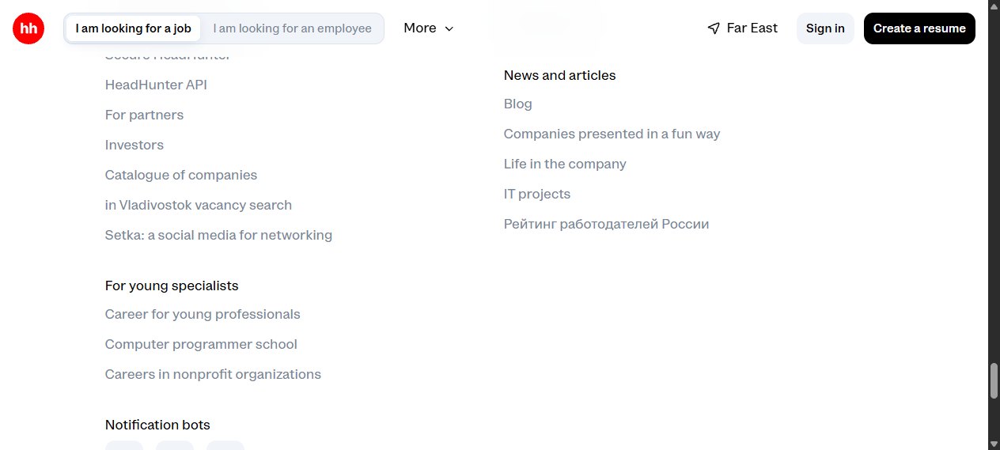
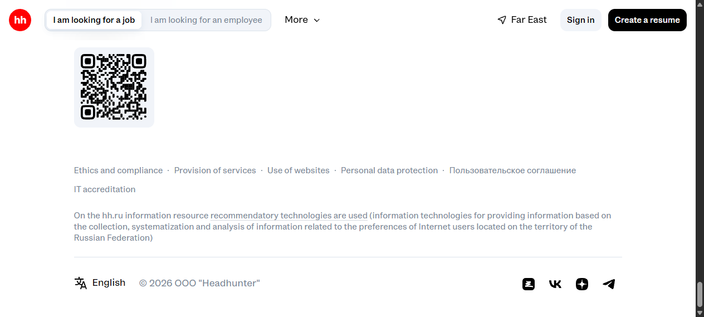
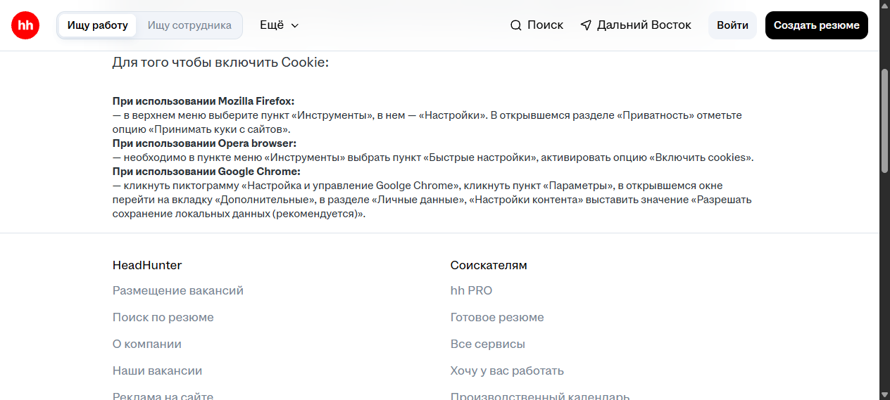

# Баг-репорты — футер hh.ru

## BUG-FT-01 — Две ссылки футера остаются на русском при выбранном English

- **Тип:** локализация / UI, непосредственно футер.
- **Severity:** Low (Minor). **Priority:** Low — предложение для триажа тимлидом.
- **Статус:** New, наблюдение воспроизведено; ожидаемое требование локализации нуждается в подтверждении владельцем продукта.
- **URL:** https://vladivostok.hh.ru/
- **Окружение:** Chromium 145, Windows, 1264×569, без авторизации.
- **Предусловия:** сайт открыт, cookies и JavaScript разрешены; русский язык; регион и cookie-баннер закрыты.

**Шаги воспроизведения:**
1. Прокрутить главную страницу до нижней строки футера.
2. Нажать «Русский» и выбрать English.
3. Дождаться обновления страницы.
4. В футере в группе News and articles посмотреть ссылку рейтинга работодателей.
5. Прокрутить до нижних правовых ссылок и посмотреть ссылку соглашения.

**Ожидаемый результат:** подписи навигационных ссылок соответствуют выбранному English, например Employers rating in Russia и User agreement. Это QA-ожидание, не цитата из спецификации.

**Фактический результат:** остаются русские подписи «Рейтинг работодателей России» и «Пользовательское соглашение». Рядом отображаются английские IT projects, Ethics and compliance, Personal data protection; переключатель показывает English.

**Воспроизводимость:** наблюдалось при двух переключениях RU → EN. После проверки возвращён русский язык.

**Влияние:** смешанный язык навигации; для англоязычного пользователя назначение двух ссылок может быть непонятно. Переходы по этим двум ссылкам в EN отдельно не проверялись.

**Доказательства:**

## BUG-FT-02 — Опечатка «Goolge Chrome» на странице «Требования к ПО»

- **Тип:** контент / орфография. **Граница:** связанная из футера страница, не сам футер. Если задание строго ограничено DOM футера, считать дополнительным замечанием.
- **Severity:** Low (Minor). **Priority:** Low — предложение для триажа тимлидом.
- **Статус:** New, воспроизведён.
- **URL:** https://vladivostok.hh.ru/article/176?from=footer_new&hhtmFromLabel=footer_new&hhtmFrom=main
- **Окружение:** Chromium 145, Windows, 1264×569, русский язык, без авторизации.
- **Предусловия:** открыта главная https://vladivostok.hh.ru/, cookies и JavaScript разрешены.

**Шаги воспроизведения:**
1. Прокрутить главную страницу до футера.
2. Нажать «Требования к ПО» в группе HeadHunter.
3. На открывшейся странице прокрутить до блока «Для того чтобы включить Cookie».
4. Найти подзаголовок «При использовании Google Chrome» и прочитать абзац под ним.

**Ожидаемый результат:** в инструкции написано «Настройка и управление Google Chrome».

**Фактический результат:** написано «Настройка и управление Goolge Chrome». В подзаголовке название написано правильно.

**Воспроизводимость:** подтверждено двумя повторными переходами с главной через футер.

**Влияние:** текстовая ошибка справки, переход не блокирует и функциональность футера не нарушает.

**Доказательства:**

