# Ручное тестирование футера hh.ru

Выполнено 13 тест-кейсов: 11 Passed, 2 Failed. Оформлено 2 баг-репорта: 1 в футере и 1 на странице, открываемой из футера.

## Окружение и границы проверки

- Дата начала: 2026-11-03T12:30:48.904706+10:00.
- Сайт: https://vladivostok.hh.ru/
- Браузер: Chromium / HeadlessChrome 145.0.0.0, Windows (идентификация из User-Agent).
- Desktop viewport: 1264×569; адаптивный вид: 390×844, эмуляция в том же браузере.
- Сессия без авторизации, язык RU; EN для локализации.
- Сценарии выполнены ассистентом через управление браузером и осмотр реальных скриншотов. Автотесты Playwright не добавлялись и не запускались.
- Проверка выборочная: шесть переходов по ссылкам, отображение, меню языков, смена языка, локализация и адаптивный вид. Не все ссылки футера проверены.
- Ожидания сформулированы по назначению интерфейса: техническое задание и продуктовая спецификация не предоставлены. В частности, требование полного английского перевода требует подтверждения тимлида.
- Не проверялись: все внешние ссылки и соцсети, QR-код, скачивание приложения, авторизованная сессия, реальные телефоны, другие браузеры, клавиатурная доступность и контрастность. Консольные ошибки не включены в результаты.
- Дефекты сайта не исправлялись; регистрация, отправка откликов и изменение пользовательских данных не выполнялись.

## Сводная таблица

| ID | Проверка | Статус | Баг |
|---|---|---|---|
| TC-FT-01 | Отображение футера на настольном экране | Passed | — |
| TC-FT-02 | Переход по ссылке «О компании» | Passed | — |
| TC-FT-03 | Переход по ссылке «Пользовательское соглашение» | Passed | — |
| TC-FT-04 | Переход по ссылке «Защита персональных данных» | Passed | — |
| TC-FT-05 | Переход по ссылке «Производственный календарь» | Passed | — |
| TC-FT-06 | Переход по ссылке «Требования к ПО» | Passed | — |
| TC-FT-07 | Переход по ссылке «Безопасный HeadHunter» | Passed | — |
| TC-FT-08 | Открытие меню выбора языка | Passed | — |
| TC-FT-09 | Переключение базового интерфейса футера на English | Passed | — |
| TC-FT-10 | Возврат с English на русский | Passed | — |
| TC-FT-11 | Полнота английской локализации навигационных ссылок футера | Failed | BUG-FT-01 |
| TC-FT-12 | Адаптивное отображение футера при ширине 390 px | Passed | — |
| TC-FT-13 | Корректность написания названия браузера на странице из футера | Failed | BUG-FT-02 |

## Подробные тест-кейсы

### TC-FT-01 — Отображение футера на настольном экране

**Приоритет:** Medium. **Статус:** Passed. **Баг:** —.

**Предусловия:** Открыт https://vladivostok.hh.ru/; пользователь не авторизован; выбран русский язык; JavaScript и cookies включены; окно выбора региона закрыто кнопкой «Да, верно», cookie-баннер — «Понятно» (если отображаются). Разрешение 1264×569.

**Шаги:**
1. Прокрутить главную страницу до начала футера.
2. Осмотреть группы ссылок и прокрутить до конца страницы.
3. Проверить правовые ссылки, переключатель языка и строку копирайта.

**Ожидаемый результат:** Футер доступен при прокрутке, группы и ссылки читаемы, внизу есть язык и копирайт.

**Фактический результат:** Отображаются группы HeadHunter, «Соискателям», «Новости и статьи», «Молодым специалистам», блоки ботов и приложения; внизу — правовые ссылки, «Русский», © 2026 ООО «Хэдхантер».

**Доказательства:**

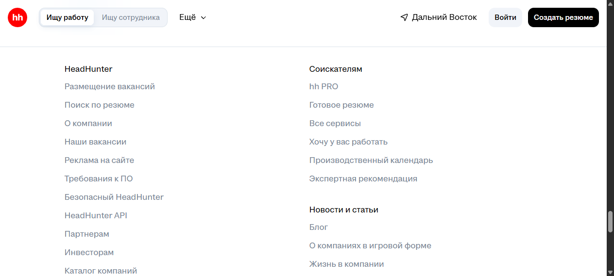

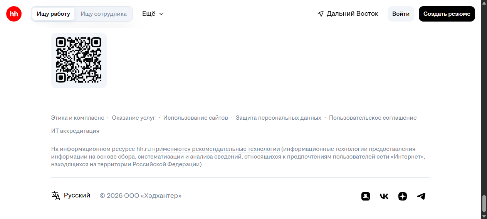

### TC-FT-02 — Переход по ссылке «О компании»

**Приоритет:** Medium. **Статус:** Passed. **Баг:** —.

**Предусловия:** Открыт https://vladivostok.hh.ru/; пользователь не авторизован; выбран русский язык; JavaScript и cookies включены; окно выбора региона закрыто кнопкой «Да, верно», cookie-баннер — «Понятно» (если отображаются). Разрешение 1264×569.

**Шаги:**
1. Прокрутить главную страницу до футера.
2. Нажать ссылку «О компании».
3. Дождаться загрузки и проверить адрес, заголовок и содержание страницы.

**Ожидаемый результат:** Открывается страница с заголовком «О компании» и описанием HeadHunter.

**Фактический результат:** Открыт URL https://vladivostok.hh.ru/article/28?from=footer_new&hhtmFromLabel=footer_new&hhtmFrom=main. Заголовок вкладки: Компания HeadHunter. Соответствующий содержательный раздел отображается; страница ошибки не появилась.

**Доказательства:**

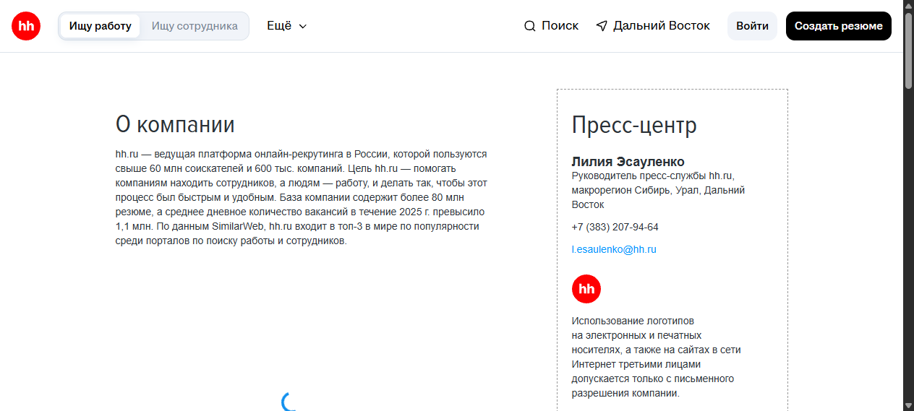

### TC-FT-03 — Переход по ссылке «Пользовательское соглашение»

**Приоритет:** Medium. **Статус:** Passed. **Баг:** —.

**Предусловия:** Открыт https://vladivostok.hh.ru/; пользователь не авторизован; выбран русский язык; JavaScript и cookies включены; окно выбора региона закрыто кнопкой «Да, верно», cookie-баннер — «Понятно» (если отображаются). Разрешение 1264×569.

**Шаги:**
1. Прокрутить главную страницу до футера.
2. Нажать ссылку «Пользовательское соглашение».
3. Дождаться загрузки и проверить адрес, заголовок и содержание страницы.

**Ожидаемый результат:** Открывается соглашение по содействию в трудоустройстве, доступен текст документа.

**Фактический результат:** Открыт URL https://vladivostok.hh.ru/account/agreement?from=footer_new&hhtmFromLabel=footer_new&hhtmFrom=main. Заголовок вкладки: Соглашение по содействию в трудоустройстве и иных видах занятости. Соответствующий содержательный раздел отображается; страница ошибки не появилась.

**Доказательства:**

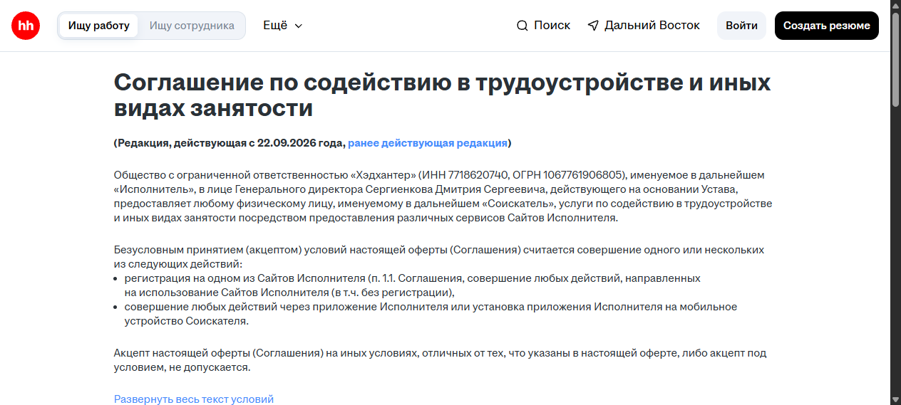

### TC-FT-04 — Переход по ссылке «Защита персональных данных»

**Приоритет:** Medium. **Статус:** Passed. **Баг:** —.

**Предусловия:** Открыт https://vladivostok.hh.ru/; пользователь не авторизован; выбран русский язык; JavaScript и cookies включены; окно выбора региона закрыто кнопкой «Да, верно», cookie-баннер — «Понятно» (если отображаются). Разрешение 1264×569.

**Шаги:**
1. Прокрутить главную страницу до футера.
2. Нажать ссылку «Защита персональных данных».
3. Дождаться загрузки и проверить адрес, заголовок и содержание страницы.

**Ожидаемый результат:** Открывается политика в области обработки и обеспечения безопасности персональных данных.

**Фактический результат:** Открыт URL https://vladivostok.hh.ru/article/personal_data?from=footer_new&hhtmFromLabel=footer_new&hhtmFrom=main. Заголовок вкладки: Политика в области обработки и обеспечения безопасности персональных данных. Соответствующий содержательный раздел отображается; страница ошибки не появилась.

**Доказательства:**

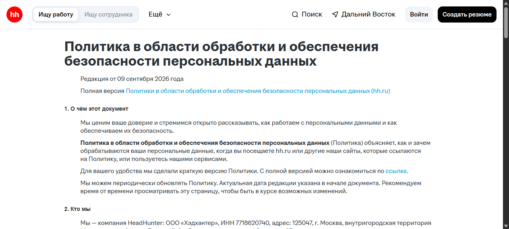

### TC-FT-05 — Переход по ссылке «Производственный календарь»

**Приоритет:** Medium. **Статус:** Passed. **Баг:** —.

**Предусловия:** Открыт https://vladivostok.hh.ru/; пользователь не авторизован; выбран русский язык; JavaScript и cookies включены; окно выбора региона закрыто кнопкой «Да, верно», cookie-баннер — «Понятно» (если отображаются). Разрешение 1264×569.

**Шаги:**
1. Прокрутить главную страницу до футера.
2. Нажать ссылку «Производственный календарь».
3. Дождаться загрузки и проверить адрес, заголовок и содержание страницы.

**Ожидаемый результат:** Открывается страница производственного календаря с указанием года.

**Фактический результат:** Открыт URL https://vladivostok.hh.ru/calendar?from=footer_new&hhtmFromLabel=footer_new&hhtmFrom=main. Заголовок вкладки: Производственный календарь на 2026 год: рабочие дни, праздники и выходные. Соответствующий содержательный раздел отображается; страница ошибки не появилась.

**Доказательства:**

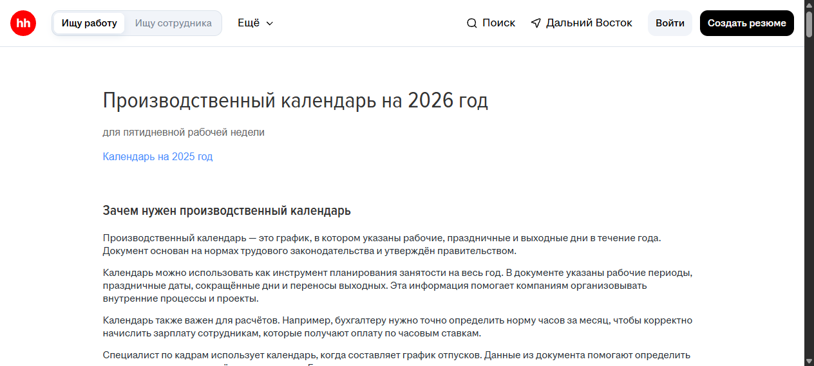

### TC-FT-06 — Переход по ссылке «Требования к ПО»

**Приоритет:** Medium. **Статус:** Passed. **Баг:** —.

**Предусловия:** Открыт https://vladivostok.hh.ru/; пользователь не авторизован; выбран русский язык; JavaScript и cookies включены; окно выбора региона закрыто кнопкой «Да, верно», cookie-баннер — «Понятно» (если отображаются). Разрешение 1264×569.

**Шаги:**
1. Прокрутить главную страницу до футера.
2. Нажать ссылку «Требования к ПО».
3. Дождаться загрузки и проверить адрес, заголовок и содержание страницы.

**Ожидаемый результат:** Открывается страница «Требования к ПО», содержащая технические требования.

**Фактический результат:** Открыт URL https://vladivostok.hh.ru/article/176?from=footer_new&hhtmFromLabel=footer_new&hhtmFrom=main. Заголовок вкладки: Требования к ПО. Соответствующий содержательный раздел отображается; страница ошибки не появилась.

**Доказательства:**

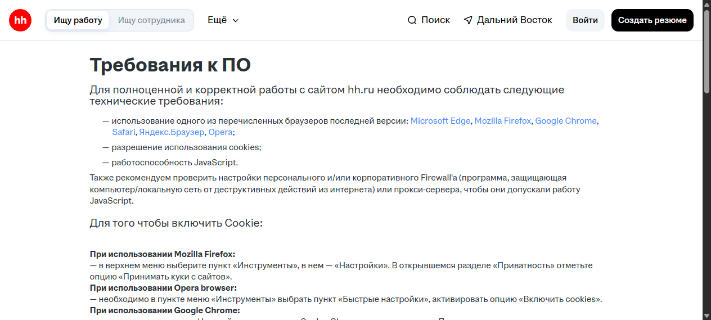

### TC-FT-07 — Переход по ссылке «Безопасный HeadHunter»

**Приоритет:** Medium. **Статус:** Passed. **Баг:** —.

**Предусловия:** Открыт https://vladivostok.hh.ru/; пользователь не авторизован; выбран русский язык; JavaScript и cookies включены; окно выбора региона закрыто кнопкой «Да, верно», cookie-баннер — «Понятно» (если отображаются). Разрешение 1264×569.

**Шаги:**
1. Прокрутить главную страницу до футера.
2. Нажать ссылку «Безопасный HeadHunter».
3. Дождаться загрузки и проверить адрес, заголовок и содержание страницы.

**Ожидаемый результат:** Открывается раздел безопасного поиска работы с рекомендациями.

**Фактический результат:** Открыт URL https://vladivostok.hh.ru/safety?from=footer_new&hhtmFromLabel=footer_new&hhtmFrom=main. Заголовок вкладки: Безопасный HeadHunter. Соответствующий содержательный раздел отображается; страница ошибки не появилась.

**Доказательства:**

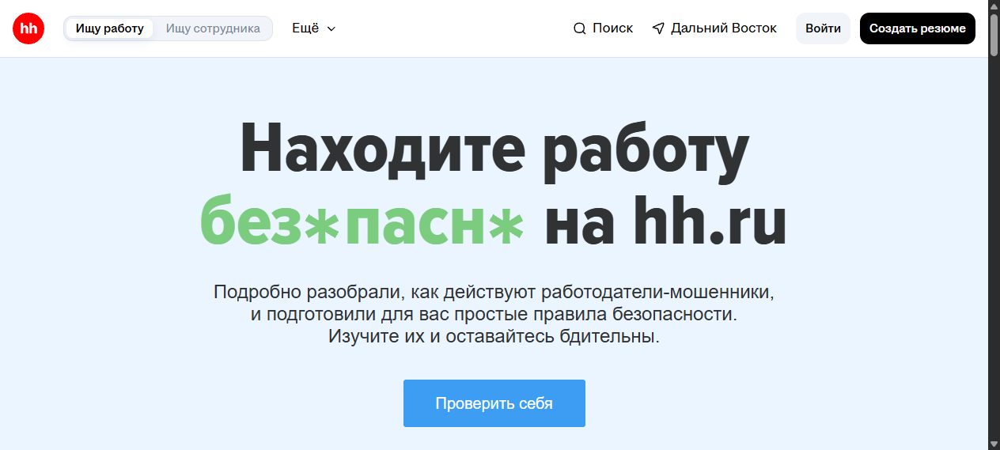

### TC-FT-08 — Открытие меню выбора языка

**Приоритет:** Medium. **Статус:** Passed. **Баг:** —.

**Предусловия:** Открыт https://vladivostok.hh.ru/; пользователь не авторизован; выбран русский язык; JavaScript и cookies включены; окно выбора региона закрыто кнопкой «Да, верно», cookie-баннер — «Понятно» (если отображаются). Разрешение 1264×569.

**Шаги:**
1. Прокрутить страницу до нижней строки футера.
2. Нажать «Русский».
3. Осмотреть список языков.

**Ожидаемый результат:** Появляется список языков; текущий русский язык отмечен.

**Фактический результат:** Отображаются Русский, English, Қазақша, O'zbek (Beta), Кыргыз (Beta); напротив русского — отметка выбора.

**Доказательства:**

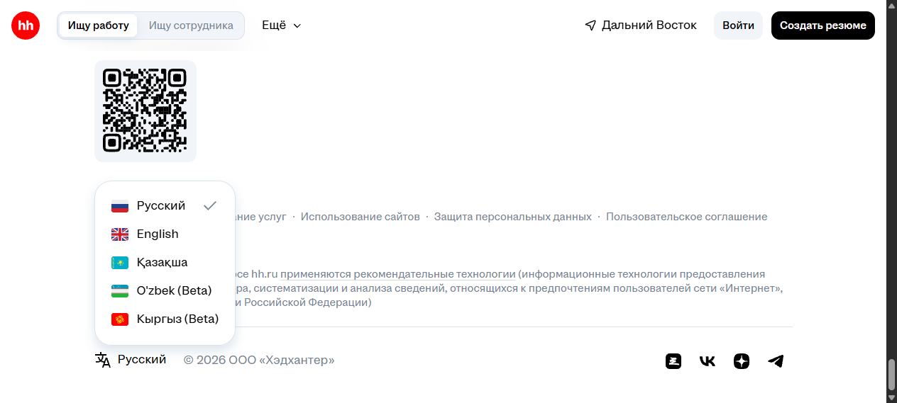

### TC-FT-09 — Переключение базового интерфейса футера на English

**Приоритет:** Medium. **Статус:** Passed. **Баг:** —.

**Предусловия:** Открыт https://vladivostok.hh.ru/; пользователь не авторизован; выбран русский язык; JavaScript и cookies включены; окно выбора региона закрыто кнопкой «Да, верно», cookie-баннер — «Понятно» (если отображаются). Разрешение 1264×569.

**Шаги:**
1. В футере нажать «Русский».
2. Выбрать English.
3. Дождаться обновления, прокрутить до футера.
4. Проверить подпись языка и несколько основных ссылок.

**Ожидаемый результат:** Подпись языка становится English; основные проверяемые ссылки переводятся: About the company, Software requirements, Production calendar.

**Фактический результат:** Подпись English и указанные переводы отображаются. Это проверка самого переключения, а не полноты перевода (полнота — TC-FT-11).

**Доказательства:**

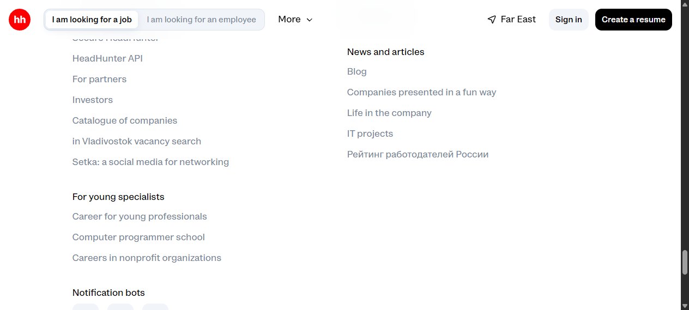

### TC-FT-10 — Возврат с English на русский

**Приоритет:** Medium. **Статус:** Passed. **Баг:** —.

**Предусловия:** Открыт https://vladivostok.hh.ru/; пользователь не авторизован; выбран English; JavaScript и cookies включены; окно выбора региона закрыто кнопкой «Да, верно», cookie-баннер — «Понятно» (если отображаются). Разрешение 1264×569.

**Шаги:**
1. Нажать English внизу футера.
2. Выбрать Русский.
3. Дождаться обновления и осмотреть нижнюю строку.

**Ожидаемый результат:** Переключатель показывает «Русский», правовые ссылки возвращаются на русский язык.

**Фактический результат:** Отображаются «Русский», «Этика и комплаенс», «Защита персональных данных», © 2026 ООО «Хэдхантер».

**Доказательства:**

### TC-FT-11 — Полнота английской локализации навигационных ссылок футера

**Приоритет:** Medium. **Статус:** Failed. **Баг:** BUG-FT-01.

**Предусловия:** Открыт https://vladivostok.hh.ru/; пользователь не авторизован; выбран русский язык; JavaScript и cookies включены; окно выбора региона закрыто кнопкой «Да, верно», cookie-баннер — «Понятно» (если отображаются). Разрешение 1264×569.

**Шаги:**
1. В футере выбрать English.
2. Осмотреть ссылку рейтинга в группе News and articles.
3. Прокрутить до нижних правовых ссылок.
4. Проверить подпись ссылки пользовательского соглашения.
5. Переключить на русский и повторно на English для проверки воспроизводимости.

**Ожидаемый результат:** При выбранном English навигационные подписи футера отображаются на английском, без оставшихся русских подписей (принятое QA-ожидание; спецификация продукта не предоставлена).

**Фактический результат:** Две подписи остаются на русском: «Рейтинг работодателей России» и «Пользовательское соглашение»; соседние ссылки переведены. Наблюдение повторилось при втором переключении.

**Доказательства:**

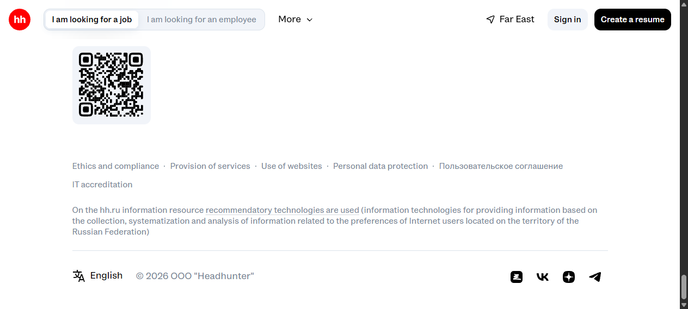

### TC-FT-12 — Адаптивное отображение футера при ширине 390 px

**Приоритет:** Medium. **Статус:** Passed. **Баг:** —.

**Предусловия:** Открыт https://vladivostok.hh.ru/; пользователь не авторизован; выбран русский язык; JavaScript и cookies включены; окно выбора региона закрыто кнопкой «Да, верно», cookie-баннер — «Понятно» (если отображаются). Разрешение 1264×569. Для проверки используется эмуляция 390×844; отдельный мобильный браузер не использовался.

**Шаги:**
1. Установить в браузере эмуляцию области просмотра 390×844.
2. Открыть главную страницу и при появлении приглашения входа закрыть его крестиком, не авторизуясь.
3. Прокрутить до футера и осмотреть верхние группы ссылок.
4. Прокрутить до нижних правовых ссылок и копирайта.
5. Проверить отсутствие горизонтального переполнения.

**Ожидаемый результат:** В просмотренных областях ссылки читаемы и укладываются по ширине; нижние элементы доступны вертикальной прокруткой.

**Фактический результат:** Верхние группы и нижние правовые ссылки доступны; строки переносятся, низ футера читаем. Ширина области и scrollWidth равны 390 px: горизонтального переполнения не обнаружено. Это эмуляция, не проверка на реальном телефоне.

**Доказательства:**

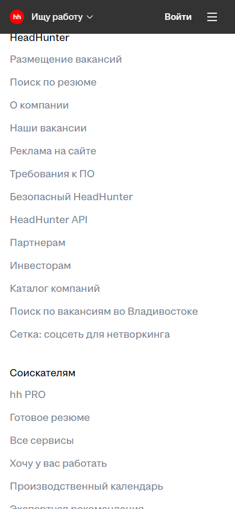

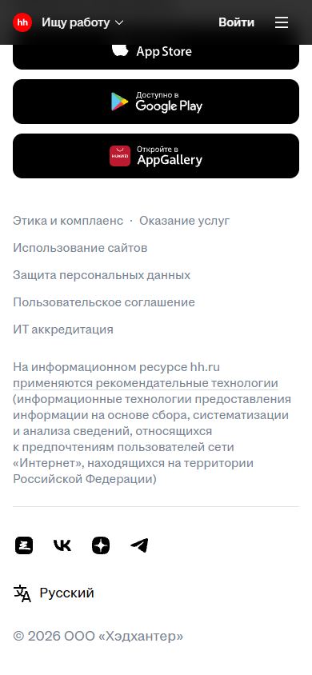

### TC-FT-13 — Корректность написания названия браузера на странице из футера

**Приоритет:** Medium. **Статус:** Failed. **Баг:** BUG-FT-02.

**Предусловия:** Открыт https://vladivostok.hh.ru/; пользователь не авторизован; выбран русский язык; JavaScript и cookies включены; окно выбора региона закрыто кнопкой «Да, верно», cookie-баннер — «Понятно» (если отображаются). Разрешение 1264×569.

**Шаги:**
1. В футере главной страницы нажать «Требования к ПО».
2. Прокрутить до инструкции «При использовании Google Chrome».
3. Прочитать следующий абзац о настройках браузера.
4. Вернуться на главную и повторить переход.

**Ожидаемый результат:** Название Google Chrome написано без опечатки в заголовке и инструкции.

**Фактический результат:** В заголовке Google Chrome, а в инструкции — «Настройка и управление Goolge Chrome». Опечатка подтверждена двумя повторными переходами. Замечание относится к связанной странице, не к тексту самого футера.

**Доказательства:**

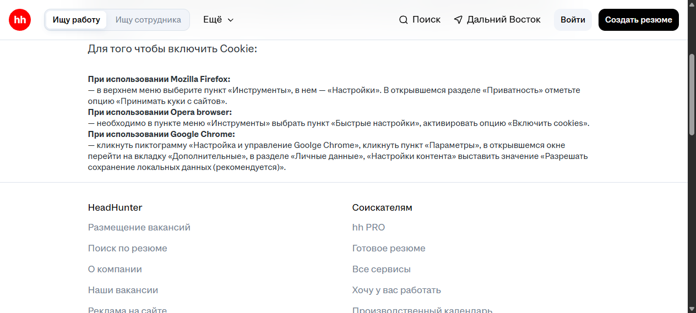

